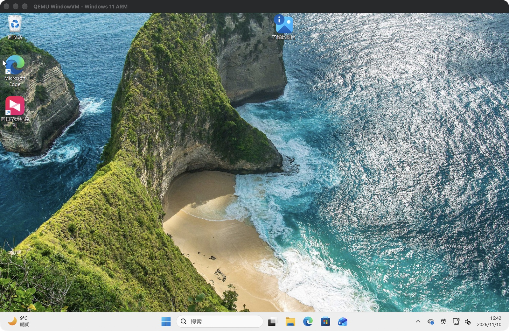
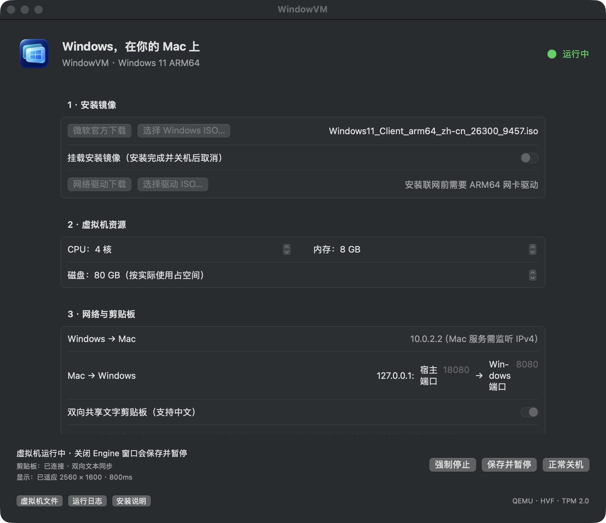
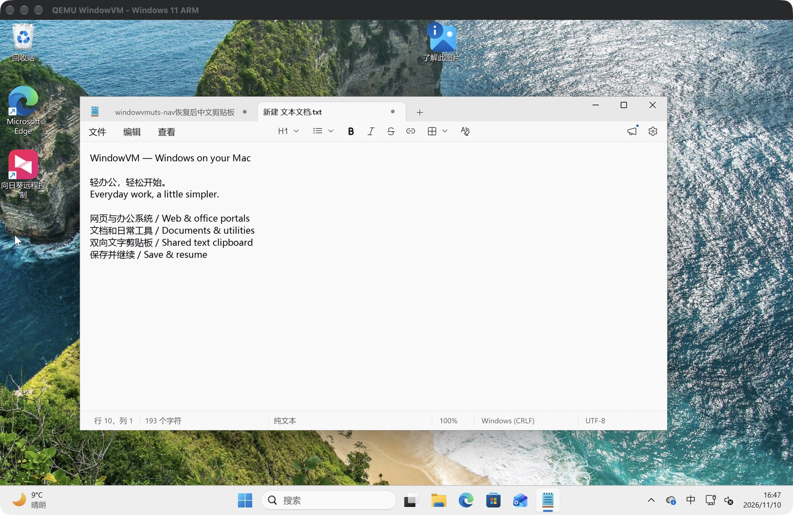

# WindowVM

**在 Mac 上，轻松处理 Windows 轻办公。**<br>
**Windows for everyday work on your Mac.**



<table>
<tr><td width="50%"></td><td width="50%"></td></tr>
<tr><td align="center">资源、网络与剪贴板管理 · VM controls</td><td align="center">Windows 轻办公实机截图 · Everyday Windows work</td></tr>
</table>

[中文](#中文) · [English](#english) · [下载安装包 / Download](https://github.com/Drok1015/WindowVM/releases/latest)

## 中文

WindowVM 是为 Apple 芯片 Mac 打造的开源 Windows 11 ARM 虚拟机应用。原生 SwiftUI 管理界面，基于 QEMU 和 macOS Hypervisor.framework 硬件虚拟化，主打浏览网页、办公系统、文档处理和偶尔需要的 Windows 小工具。

这是早期预览版本，适合愿意自行安装 Windows 和运行依赖的用户。办公软件需自行安装；兼容性取决于 Windows ARM 和具体软件，尚未对完整 Office 套件或企业软件逐项验证。

### 轻办公所需的功能

- **原生管理界面**：配置 CPU、内存、稀疏磁盘与安装镜像，默认 4 核 / 8 GB / 80 GB。
- **清晰的 Windows 窗口**：支持 Retina 和窗口大小自适应，需安装随附显示驱动与配套程序。
- **双向文字剪贴板**：Mac 与 Windows 之间复制中文、英文和 emoji；暂不支持文件或图片剪贴板。
- **保存并继续**：关闭 Engine 窗口会保存内存与设备状态，下次打开继续操作；不是多版本快照。
- **网络互通**：NAT 上网、访问 Mac 服务、仅绑定本机的 TCP 端口转发。
- **宿主代理助手**：按需将 Mac HTTP/HTTPS 系统代理应用到 Windows 当前用户，并支持恢复原设置。
- **独立数据目录**：虚拟机文件保存在 `~/Library/Application Support/WindowVM/Windows11`。

### 下载与安装

1. 使用 **Apple 芯片 Mac**。当前 **v0.1.0 预编译安装包要求 macOS 27 或以上**，因为随附的 Homebrew QEMU 11.1.3 二进制以 macOS 27 为最低版本。Swift 应用源码目标为 macOS 14+，较旧系统需自行构建兼容的 QEMU，未验证。
2. 安装 [Homebrew](https://brew.sh)，然后在终端运行：

   ```sh
   /opt/homebrew/bin/brew install qemu swtpm
   ```

3. 从 [Releases](https://github.com/Drok1015/WindowVM/releases/latest) 下载 `WindowVM-0.1.0-macos-arm64.dmg`，打开后将 `WindowVM.app` 拖入“应用程序”。**当前安装包仍需要 Homebrew 的运行库和工具，不是独立运行包。**
4. 应用采用 ad-hoc 签名，尚未获得 Apple 开发者签名和公证。若 macOS 拦截，在确认下载来源后，按照“系统设置 → 隐私与安全性”的提示允许打开。
5. 启动应用，通过 [微软官方下载 Windows 11 ARM64 ISO](https://www.microsoft.com/zh-cn/software-download/windows11arm64)，选择镜像并创建虚拟机。安装联网需要 VirtIO ISO 中的 ARM64 NetKVM 驱动，应用内有下载入口。
6. Windows 安装完成后，在 `WINDOWVM_TOOLS` 光盘运行 `Install.cmd` 启用文字剪贴板，再运行 `InstallDisplay.cmd` 安装显示驱动；后者需要 Windows 管理员确认。安装完成并正常关机后，取消挂载安装镜像。

Windows 镜像、已安装系统和许可证均不包含在下载包内，需要自行获取与授权。应用界面目前为中文；本项目文档提供中英双语。

### 使用提示与边界

- Windows 访问 Mac 服务使用 `10.0.2.2:端口`；Mac 通过配置的 `127.0.0.1:宿主端口` 访问 Windows 服务。Windows 防火墙需按服务单独配置。
- 需要 Mac 代理时，在工具光盘运行 `UseHostProxy.cmd`；用 `RestoreProxy.cmd` 恢复。暂不转换 PAC 或仅 SOCKS 配置。
- 暂停后不要修改虚拟机文件、移动应用或升级 QEMU/swtpm；请先继续并正常关机。恢复失败时保留原文件，避免内存与磁盘错配。
- 备份前正常关机，并整体备份虚拟机目录，包括磁盘、UEFI 变量与 TPM 状态。
- 暂不支持 3D 加速、音频、共享文件夹、桥接网络、多虚拟机管理或多版本快照。游戏、重度图形工作和需要特殊硬件驱动的软件不在当前定位内。
- 仅支持 Windows ARM 客体；不提供 x86 Windows 系统虚拟化。Windows 自身对 x86/x64 应用的兼容能力取决于具体应用。

### 从源码构建

需要 Apple 芯片 Mac、Xcode Command Line Tools / Swift 5.9+ 和 `/opt/homebrew` 下的 Homebrew。

```sh
git clone https://github.com/Drok1015/WindowVM.git
cd WindowVM
./scripts/setup.sh
./scripts/build.sh
open build/WindowVM.app
```

```sh
swift test
./scripts/test-display.sh
python3 scripts/smoke.py
python3 scripts/smoke-suspend.py
```

显示适配目前针对 QEMU 11.1.3，升级 QEMU 后需重新验证。9 项 Swift 测试及原生显示适配测试已通过；真实 Windows 的网络、双向剪贴板、分辨率适配和暂停恢复记录见 [开发说明](docs/DEVELOPMENT.zh-CN.md) 与 `docs/verification-*.txt`。

## English

WindowVM is an open-source Windows 11 ARM virtual machine app for Apple silicon Macs. It combines a native SwiftUI manager with QEMU and macOS hardware virtualization through Hypervisor.framework, focusing on web browsing, office portals, documents, and occasional Windows utilities.

This is an early preview for users comfortable installing Windows and its runtime dependencies. Bring your own office applications. Compatibility depends on Windows ARM and each application; full Office suites and enterprise applications have not been individually validated.

### Features for everyday work

- **Native controls** for CPU, memory, installation media, and a sparse disk; defaults to 4 cores / 8 GB RAM / 80 GB storage.
- **Retina-aware display resizing** after installing the included display driver and guest helper.
- **Bidirectional text clipboard**, including Chinese and emoji. File and image clipboard transfer is not supported.
- **Save and resume** when closing the Engine window. One pending saved state, rather than a history of snapshots.
- **NAT networking**, access to Mac services, and a TCP forwarding rule bound to localhost.
- **Host proxy helper** to apply Mac HTTP/HTTPS proxy settings to the current Windows user and restore previous settings.
- **Separate VM storage** at `~/Library/Application Support/WindowVM/Windows11`.

### Download and install

1. Use an **Apple silicon Mac**. The **v0.1.0 prebuilt download requires macOS 27 or later** because its bundled Homebrew QEMU 11.1.3 binary targets macOS 27. The Swift source targets macOS 14+, but older systems require a separately built compatible QEMU and have not been tested.
2. Install [Homebrew](https://brew.sh), then run:

   ```sh
   /opt/homebrew/bin/brew install qemu swtpm
   ```

3. Download `WindowVM-0.1.0-macos-arm64.dmg` from [Releases](https://github.com/Drok1015/WindowVM/releases/latest). Open it and drag `WindowVM.app` into Applications. **Homebrew libraries and tools are still required; this is not a standalone bundle.**
4. The app is ad-hoc signed and is not Apple Developer signed or notarized. If macOS blocks it, verify the download source and follow the approval prompt under System Settings → Privacy & Security.
5. Open WindowVM, download an official [Windows 11 ARM64 ISO](https://www.microsoft.com/en-us/software-download/windows11arm64), select it, and create the VM. Networking during installation needs the ARM64 NetKVM driver from the VirtIO ISO linked in the app.
6. Inside Windows, run `Install.cmd` from the `WINDOWVM_TOOLS` CD for clipboard integration, then `InstallDisplay.cmd` for the display driver. The display installer requires Windows administrator approval. After installation and a normal shutdown, unmount the Windows installer ISO.

Windows installation media, a preinstalled OS, and licenses are not included. Obtain and license Windows separately. The app interface is currently Chinese; project documentation is bilingual.

### Practical limits

- Reach Mac services through `10.0.2.2:port`; reach forwarded Windows services through `127.0.0.1:host-port` on the Mac. Configure the Windows firewall for each service as needed.
- Use `UseHostProxy.cmd` on the tools CD when a Mac proxy is needed; `RestoreProxy.cmd` restores prior settings. PAC and SOCKS-only configurations are not converted.
- Resume and shut down normally before moving the app, modifying VM files, or upgrading QEMU/swtpm. Saved memory, disk, UEFI, and TPM state must remain together.
- Back up the entire VM directory after a normal shutdown.
- No 3D acceleration, audio, shared folders, bridged networking, multiple VM management, or snapshot history. Gaming, demanding graphics, and applications requiring special hardware drivers are outside the current scope.
- Only ARM Windows guests are supported. Compatibility with x86/x64 applications is provided by Windows itself and varies by application.

### Build from source

Requires Apple silicon, Xcode Command Line Tools / Swift 5.9+, and Homebrew in `/opt/homebrew`.

```sh
git clone https://github.com/Drok1015/WindowVM.git
cd WindowVM
./scripts/setup.sh
./scripts/build.sh
open build/WindowVM.app
```

Run `swift test` and `./scripts/test-display.sh` for unit/native checks. After building, `python3 scripts/smoke.py` and `python3 scripts/smoke-suspend.py` exercise hardware virtualization in temporary VMs. Display integration currently targets QEMU 11.1.3 and must be revalidated after upgrades. Nine Swift tests and the native display checks pass; Windows integration evidence is in `docs/verification-*.txt`.

## Source layout / 代码结构

| Path | Purpose / 用途 |
| --- | --- |
| `Sources/VMCore` | Configuration, launch arguments, proxy mapping / 配置、启动参数、代理映射 |
| `Sources/WindowVM` | SwiftUI, lifecycle, QMP, clipboard bridge / 界面、生命周期、控制、剪贴板 |
| `NativeDisplay` | Cocoa display and Engine launcher / 显示适配与引擎启动器 |
| `Guest` | Windows helpers and signed ARM64 display driver / Windows 配套程序与显示驱动 |
| `scripts` | Build, setup, packaging and smoke tests / 构建、安装、打包与验证 |

## License & credits / 许可证与致谢

WindowVM original code is licensed under **GPL-2.0-only**; see [LICENSE](LICENSE). Third-party components retain their own licenses; see [THIRD_PARTY_NOTICES.md](THIRD_PARTY_NOTICES.md). / WindowVM 原创代码采用 GPL-2.0-only，第三方组件保留各自许可证。

Built with [QEMU](https://www.qemu.org/), [swtpm](https://github.com/stefanberger/swtpm), [TianoCore EDK II](https://github.com/tianocore/edk2), [Ubuntu AAVMF](https://packages.ubuntu.com/noble-updates/qemu-efi-aarch64), and [virtio-win](https://github.com/virtio-win/kvm-guest-drivers-windows). WindowVM is an independent project, unaffiliated with Apple or Microsoft. / 本项目独立开发，与 Apple 或 Microsoft 无关联。
